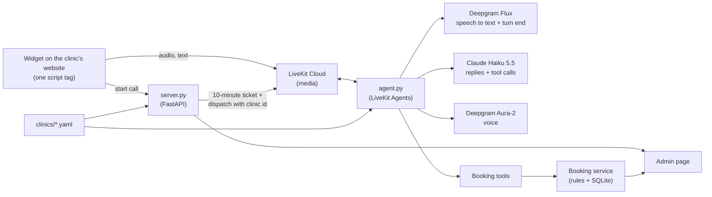

# Kora: an AI receptionist for clinics

Kora answers patients through a voice widget on a clinic's website. It books, moves and cancels appointments, answers questions using only the clinic's own information, and passes emergencies and callback requests to the staff. A new clinic is a config file, not new code.

**Live demo:** coming soon at `demo.buildaditya.com` · **More:** [buildaditya.com](https://buildaditya.com)

<!-- Add the demo GIF or video here once recorded:  -->

> This is a working demo built around a fictional dental clinic in Paris. It is not yet set up for real patient data (see [Status](#status)).

## What a caller can do

| Job | How it works |
|---|---|
| Book an appointment | Checks real free slots, reads back the caller's name and number, then saves the booking. Respects opening hours, service durations, buffers, notice periods and closed days. |
| Reschedule or cancel | Finds the caller's appointments by phone number. Warns about the clinic's late-cancellation policy before confirming. |
| Ask a question | Hours, address, prices, services, preparation, policies. Answers only from the clinic's config and says so when it doesn't know. |
| Report an emergency | Life-threatening: tells the caller to ring 15 or 112 first. Urgent: offers the earliest emergency slot, or an urgent callback from the team. |
| Ask for a human | Says plainly it can't transfer the call, then leaves a callback request for the staff. |
| Type instead of talk | The widget has a text box; same agent, same tools. |

The agent tells the caller it is an AI in its first sentence, and it can only change bookings through server-side tools. It never confirms anything a tool didn't do.

## Clinic staff

A simple admin page shows today's appointments, callback requests and call transcripts. Staff can edit hours, services, prices and FAQs without touching code, and erase a patient's data with one action. Transcripts delete themselves after a set number of days (30 by default).

## How it works



| Part | Choice | Why |
|---|---|---|
| Voice framework | [LiveKit Agents](https://github.com/livekit/agents) (Python) | Open source, handles interruptions and turn-taking, browser and phone support |
| Speech to text | Deepgram Flux | Detects the end of a turn itself, which removes a separate waiting step |
| LLM | Claude Haiku 5.5 | Reliable tool calling, fast first token once tuned |
| Voice | Deepgram Aura-2 | Natural voice, low latency, set per clinic |
| Voice activity | Silero VAD | Runs locally, free |
| Storage | SQLite behind a `BookingBackend` interface | Swappable for Google Calendar or practice software later |
| Web | FastAPI, plain JavaScript widget (no build step) | Simple to host and embed |

### Multi-clinic by design

Each clinic is one YAML file: name, greeting, hours, closed dates, practitioners, services with prices and durations, booking rules, policies, FAQs, emergency instructions and voice. The file is validated on load (for example, the greeting must say it's an AI, and every service's practitioners must exist). The widget passes the clinic id, the server attaches it to the call, and the agent loads that clinic.

## Results

Tested with 54 scripted scenarios, each played by a simulated caller (Claude Haiku 5.5) and graded by a judge model (Claude Sonnet 5.5), on a fresh database with a fixed pretend date.

| Area | Passed |
|---|---|
| Bookings, rescheduling and cancellations | 19 / 19 |
| Questions about the clinic | 11 / 11 |
| Emergencies and handover to staff | 11 / 11 |
| Prompt injection and off-topic requests | 9 / 9 |
| Unclear speech and changes of mind | 4 / 4 |
| **Total** | **54 / 54** |

A spoken checklist through the real widget also passed 10 / 10: spelled names, fast phone numbers, talking over the agent, background music, long silences, mid-sentence pauses and a clean single goodbye.

**Speed:** in spoken calls the agent typically starts replying about a second after the caller stops talking. In the text test suite, the median reply took 1.2 s.

**Cost:** about $0.02 per minute of conversation at list prices (speech, LLM and voice combined).

## What testing taught me

- **One default setting cost 1.2 seconds per reply.** The Anthropic plugin's strict tool mode was on by default. A small benchmark (`bench_llm.py`) measured 1.83 s to first token with it on, 0.65 s with it off.
- **Text becomes speech exactly as written.** The model wrote numbered lists for multiple appointments, which sounds robotic aloud. The prompt now says so explicitly, and because the model still slips now and then, a small filter (`speech_text.py`) removes list markers from the text stream before it reaches the voice.
- **Names are the weakest point.** "Aditya" was heard as "Aditi", and spelled letters arrived as one word. The agent now splits and reads back spelled names.
- **Agents invent helpful-sounding abilities.** Without a rule, it offered to "take a message" it couldn't save. Every capability is now either backed by a tool or ruled out.
- **Fix rules in code or config, not only in the prompt.** The late-cancellation warning works reliably because the lookup tool flags late appointments, rather than relying on the model to do the date arithmetic.

## Run it locally

You need [uv](https://docs.astral.sh/uv/) and accounts with [LiveKit Cloud](https://cloud.livekit.io), [Deepgram](https://console.deepgram.com) and [Anthropic](https://console.anthropic.com).

```bash
git clone https://github.com/datanerdaditya/kora-ai-receptionist.git
cd kora-ai-receptionist
uv sync
cp .env.example .env.local      # then fill in your keys
```

In two terminals:

```bash
uv run agent.py dev                          # the voice agent
uv run uvicorn server:app --port 8000        # demo page, widget and admin
```

Open http://localhost:8000 for the demo clinic and http://localhost:8000/admin for the staff page (user `admin`, password from `ADMIN_PASSWORD`).

Tests:

```bash
uv run python test_booking.py                # booking rules
uv run python test_speech_text.py            # speech clean-up filter
uv run python evals.py                       # 54 conversation scenarios (uses API credits)
```

### Add the widget to a website

```html
<script src="https://YOUR-SERVER/widget.js" data-clinic="riviere-dental"></script>
```

Optional attributes: `data-label`, `data-color`, `data-server`.

## Project layout

| File | What it does |
|---|---|
| `agent.py` | Voice pipeline and the agent's tools |
| `prompts.py` | Builds the system prompt from the clinic config |
| `agent_prompt.md` | The agent's rules and tools, written out for reading |
| `speech_text.py` | Cleans the agent's words as they stream to the voice (joins lines, drops list markers), with no added delay |
| `clinic_config.py` | Loads, validates and saves a clinic's YAML |
| `booking_service.py` | Booking rules and storage |
| `booking_tools.py` | Turns booking results into text the agent can say |
| `callback_service.py` | Callback requests for staff |
| `call_log.py` | Transcripts with automatic deletion |
| `server.py` | Call tickets, demo page, widget and admin API |
| `web/` | Widget, demo page, admin page |
| `clinics/` | One YAML file per clinic |
| `evals.py`, `eval_scenarios.py` | Automated conversation tests |

## Status

Working demo. Before real patients, it needs:

- French (the code is ready for more languages; the prompts and voice are English today)
- A phone number, not only the website widget
- Connection to the clinic's own diary or practice software
- Health-data hosting and GDPR paperwork suitable for patient data

## Licence

All rights reserved. You're welcome to read the code; please ask before reusing it.